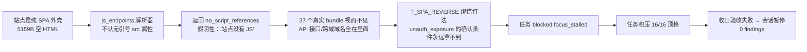

# business.oppo.com SRC 轮次复盘与优化报告

> 会话：`17e1b714fab57d6b`（2026-11-01 16:07 启动）
> 目标：`http://business.oppo.com/` ｜ 状态：paused（validation_failed_review_required）
> 预算：1M token ｜ 本轮实耗：**363,901 tokens / 10 agent turns / 8 tool calls / 288 秒**
> 结果：**0 个 findings，17 个任务 0 完成 1 阻塞 16 挂起**

---

## 一、这一轮发生了什么（一句话版）

目标是一个**纯 SPA 外壳**（5159 字节的空 HTML，正文几乎没有文字），真实接口全部藏在 JS bundle 里。但系统一开始就把这个"翻译外壳"的关键步骤卡死了，于是 36 万 token 几乎全花在**重复打同一个页面、反复规划重复任务、互相矛盾的指令**上，最后因为"任务积压满 + 收口验收不过"被暂停，一个漏洞都没确认。

---

## 二、战况速览（数据）

| 指标 | 数值 | 说明 |
|---|---|---|
| 消耗 token | 363,901 | 占 1M 预算的 36%，0 产出 |
| Agent 轮次 | 10 | 平均 ~36K token/轮 |
| 工具调用 | 8 | 大量被拒绝/空转，实际有效请求很少 |
| 任务数 | 17 | 其中 4 组是**同义重复**（同一件事起了 4 个名字） |
| 完成/阻塞/挂起 | 0 / 1 / 16 | 唯一阻塞：`T_SPA_REVERSE`（SPA 逆向） |
| 攻击图 | 33 节点 / 93 边 | 32 个端点全是静态资源（.css/.js/.ico），1 个 dead_end |
| 打法覆盖 | 仅 `unauth_exposure` | 15 条打法里唯一被调用的一条，且只走了 1 步 |
| 关键错误 | 2 | `task_backlog_full:16/16`（任务积压顶格）+ `closure_deliverables_partial:T1`（收口交付不完整） |

---

## 三、根因链（为什么 0 成果）

把会话记录、checkpoint 状态、Observer 复核意见和攻击历程图拼起来，真正的病根是**一条断掉的因果链**：



### 五个具体病灶

1. **解析器 Bug（最致命）**：`jsUrlsFromHtml` 的正则只认 `src="..."` 带引号写法。business.oppo.com 的 HTML 是压缩过的无引号写法（`<script src=/static/js/office.xxx.js>`），于是 37 个真实 bundle 被误判为"页面没有 JS"。**Observer 都看出来了**（检查记录里明确写了"js_endpoints 的 no_script_references 是解析 bug，不是站点没有 JS"），但工具本身没修。

2. **打法库缺 SPA 逆向条目**：15 条打法全部面向"业务接口型"目标，没有一条是"先把 SPA 外壳翻译成接口清单"。系统生成的 `T_SPA_REVERSE` 任务只能绑 `unauth_exposure`，它的确认条件（未授权可读数据）在纯外壳上永远满足不了 → 必然 blocked。

3. **指令/执行器自相矛盾**：执行器闸门（desk.ts）要求 `input.force_armored=true` 才能强制放行，但工具输入白名单（protocol.ts）里**根本没有 force_armored 这个键** → Observer 每次给的建议（"带 force_armored=true"）都被判"不可执行建议"，还反过来误导 Agent 以为请求被禁用。spa.ts 的提示文案也还在说"http.request 已被禁用"（实际早已放行）。

4. **焦点被零价值任务劫持**：sitemap 吐了 30 条路径，全是页面自己引用的静态资源（.css/.js/.ico），被折叠成 1 个探针 `/static/favicon.ico`——这个文件 **HTML 里本来就写着，必然 200，零信息**。系统却为它造了任务并劫持了整整一个焦点轮（focus_usage 记录：turns=1, tool_calls=0），把唯一能出结论的 SPA 逆向任务挤掉了。

5. **任务爆炸与收口过严**：同一件事被起了 4 个名字（`T1` / `T1_surface_baseline` / `baseline_surface` / `T3_baseline` 都是"建基线"），17 个任务把 16 的上限顶满；随后收口验收因为 T1 交付物"不完整"报错，直接触发 `validation_failed_review_required` 把会话暂停。

### 攻击历程图解读（实际 vs 应该）

```
实际走过的图（33 节点）：
asset:business.oppo.com → ep:/office/home（连打 4 次同字节 200 → dead_end）
                        → 30 个静态资源节点（untested，全是 sitemap 噪音）
                        → T_SPA_REVERSE 阻塞在此 —— 图到此为止

应该走的图（真实攻击面）：
asset → 外壳 HTML（5KB）→ 37 个 bundle（office.js 135KB ！）
      → axios baseURL / /api 前缀 / 跨域域名（商城/开发者平台/SSO）
      → 渲染期真实 XHR（method + 参数名）
      → 这些才是能立 IDOR/未授权/逻辑漏洞任务的端点
```

**图的最大问题**：93 条边里绝大多数是"导航到静态资源"的噪音边，真实攻击面（bundle、API、跨域域）一条边都没长出来。图"大而假"，信息量接近零。

---

## 四、本轮已落地的优化（5 个补丁）

按"改动最小、收益最大、有测试保障"的原则实施，`tsc` 编译通过，**96 个相关测试全部通过**。

| # | 文件 | 改动 | 解决的问题 |
|---|---|---|---|
| 1 | `src/blackbox/tools.ts` | `jsUrlsFromHtml` 新增无引号 `src` 属性解析 | **病灶 1**：37 个 bundle 不再被误判为空 |
| 2 | `src/blackbox/playbooks.ts` | 新增 **`spa_reverse`** 打法（外壳→bundle→sourcemap→渲染期 XHR→catch-all 判定，7 步，含 strategic 步骤与交付物模板） | **病灶 2**：SPA 目标有了专用打法，confirm 条件可达成 |
| 3 | `src/blackbox/protocol.ts` | 工具输入 schema 增加 `force_armored` 键 | **病灶 3 前半**：Observer 建议不再被判"不可执行" |
| 4 | `src/blackbox/spa.ts` | 缴械提示文案修正（http.request 不在禁用清单） | **病灶 3 后半**：不再误导 Agent |
| 5 | `src/control/console/desk.ts` | 字典探针：全部折叠为 static 类时跳过、不劫持焦点 | **病灶 4**：不再为 favicon 白烧一整轮 |

病灶 5（任务爆炸/收口）属**策略层**，未改代码，靠下一轮打法和配置规避（见第五节）。

> 新增打法 `spa_reverse` 摘要（完整定义在 `src/blackbox/playbooks.ts`）：
> 1. `shell_baseline`（http.request 匿名基线）→ 2. `shell_scripts`（recon.js_endpoints，修复后能列出 bundle）→ 3. `bundle_extract`（exec.python 三正则抠 baseURL//api/跨域域，落盘 /state/spa_bundle.json）→ 4. `sourcemap_probe`（直取 .js.map 拿原始源码）→ 5. `render_xhr`（browser.open networkidle 渲染）→ 6. `xhr_list`（browser.network 抓渲染期 XHR 与参数名）→ 7. `catch_all`（http.diff 判全站 fallback）
> confirm：bundle 抠出 baseURL//api 清单，或拿到 ≥1 条带 method 的真实 XHR —— **"外壳被翻译成接口清单"即可收口**，不再要求做不到的"未授权读数据"。

---

## 五、下一轮怎么打（1M 预算分配）

上一轮 36 万 token 空转的教训：**token 不是花在请求上，是花在"模型反复试错、重复规划、处理矛盾指令"上**。下一轮直接开新会话（旧会话已 paused，checkpoint 可留作基线对比），按下面的预算表推进：

| 阶段 | 预算 | 动作 | 产出判据 |
|---|---|---|---|
| 0. 开局 | ≤20K | 直接判定 SPA 外壳（读上一轮基线证据 `ev-bd1e6eb620204642` 即可，**不要重新请求 /office/home**） | 一句话定性 + 1 条证据引用 |
| 1. 外壳翻译 | ≤120K | 走 `spa_reverse` 打法：`recon.js_endpoints`（现在能列出 bundle）→ `exec.python` bundle 提取 → `.js.map` → `browser.open`+`browser.network` | `/state/spa_bundle.json` + ≥3 个真实 API 路径/跨域域 |
| 2. 接口立任务 | ≤150K | 把拿到的端点按形态绑打法：带对象 id → `idor`；无鉴权可读 → `unauth_exposure`；10403/登录态 → `auth_token`；跨域域名 → **作为独立资产立子任务**（这才是企业业务站的高价值面） | 3-5 个可执行任务，各带 deliverables |
| 3. 单点纵深 | ≤400K | 只挑 2 条最有把握的假设打透（如商城订单 IDOR、开发者平台未授权），用 `http.diff` 做基线/身份对照，**不信肉眼** | ≥1 条 confirmed finding |
| 4. 收口 | ≤100K | 逐任务写 `task_outcomes` + `advice_decisions`（上轮就是没写 decisions 导致 Observer 建议全部空转），交付物按任务模板补齐 | 验收通过，report.md 落地 |
| 止损线 | — | 任一阶段耗时超过预算 → 立即停，记录 blocked_reason 换下一个，**不要在同一 URL 上重复请求超过 2 次** | — |

**回合纪律**（直接把这几条写进新会话的开场指令）：

1. 禁止重复请求已探过的端点（/office/home 上轮已打 4 次，本轮 0 次）。
2. 任务总数控制在 ≤8，同类任务先查 `task_aliases` 合并，**同一件事只留一个任务名**。
3. `advice_decisions` 每轮必填——Observer 给的 next_steps 要么采纳执行、要么写明拒绝理由，不能让建议永久 pending。
4. 换端点的顺序：bundle 里抠出的真实接口 > 跨域业务域名 > 同域新路径；静态资源永不主动请求。

---

## 六、注意事项与遗留项

- **生效方式**：补丁已编译进本地 `dist/`（`npm run build` 已跑过，`tsc` 通过）。若用 Docker 控制台跑，需 `docker compose build && up -d` 重建镜像后生效；本地 `bin/nianyun console` 直接生效。
- **全量测试**：`vitest run` → 825 通过 / 3 失败（`assets.test.ts`×1、`candidates.test.ts`×2）。这 3 个失败只依赖 `src/asset/*`+`shared/db.js`，**与本次改动无关**（已做 import 依赖链验证），属本开发快照的既有问题，建议单独排查。
- **策略层建议（未改代码）**：`loop_control.task_pending_limit` 可从 16 降到 8；收口验收对"基线类"任务允许 `verified-negative` 收口（Observer 已两轮建议，值得做成配置项）。
- **同类目标复用**：OPPO 系站点（note.yun/cloud/support 等）大概率同为 SPA 外壳，`spa_reverse` 打法与 js_endpoints 修复对它们同样有效。

---

*报告基于会话 checkpoint（tasks/graph/supervision/advice/dict_probe/focus_usage）逐字段核对生成，所有数字可复现。*